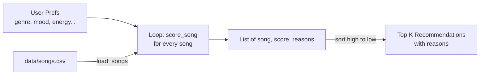

# 🎵 Music Recommender Simulation — VibeFinder 1.0

**Name:** Joshua Lookshin
**Z-number:** z23411056

## Project Summary

VibeFinder is a small, content-based music recommender written in Python. It reads a
catalog of songs from `data/songs.csv`, compares every song against a user's "taste
profile" (favorite genre, favorite mood, and target values for numbers like energy), gives
each song a score, and prints the top matches in the terminal. Every recommendation comes
with a list of reasons (for example `genre match: pop (+2.00)`), so the user can see exactly
why a song was picked.

---

## How The System Works

### How real platforms do it

Apps like Spotify, YouTube, and TikTok mix two main ideas:

- **Collaborative filtering** looks at *other users' behavior*. If many people who like
  song A also like song B, and you like song A, the system suggests song B. It doesn't need
  to know anything about the music itself, only who listened to, liked, skipped, saved, or
  playlisted what. It's great at finding surprising matches, but it struggles with brand-new
  songs or new users that have no history (the "cold start" problem).
- **Content-based filtering** looks at *the songs' own attributes*: genre, mood, tempo,
  energy, acousticness, and so on. If you like upbeat, high-energy pop, it recommends other
  songs whose attributes look like that. It works on day one, but it tends to recommend
  "more of the same."

Real systems combine both, along with signals such as play counts, skips, replays, time of
day, playlist co-occurrence, and audio analysis. The main data types involved are:

| Behavior signals (collaborative) | Song attributes (content-based) |
| --- | --- |
| likes / hearts, skips, replays | genre, mood |
| playlist adds, saves, shares | energy, tempo (BPM), valence |
| listening time, follows | danceability, acousticness |

**My version** is purely **content-based**. There are no other users to learn from, so it
puts the user's stated genre and mood first, then uses the numeric "vibe" features
(especially energy) to break ties and to reward songs that are *close* to what the user
wants.

### Features used

**`Song`** (one row of `data/songs.csv`):
`id`, `title`, `artist`, `genre`, `mood`, `energy` (0–1), `tempo_bpm`, `valence` (0–1,
musical positivity), `danceability` (0–1), `acousticness` (0–1)

**`UserProfile`** (the taste profile):
`favorite_genre`, `favorite_mood`, `target_energy` (0–1), `likes_acoustic` (True/False).
Optional targets for `valence`, `danceability`, and `tempo_bpm` can be added for a more
detailed profile.

Example taste profile (as a dictionary):

```python
user_prefs = {"genre": "pop", "mood": "happy", "energy": 0.8}
```

Is this profile enough to tell "intense rock" apart from "chill lofi"? Yes. Those two styles
differ on every field: genre (rock vs lofi), mood (intense vs chill), and energy (about 0.9
vs about 0.4). Genre and mood alone are too narrow, though. A user who loves pop but wants
something calm would get the same genre points for *Gym Hero* (intense) as for *Paper
Hearts* (sad and mellow). That's why the energy target and the optional numeric targets
matter. They separate songs *within* a genre.

### Algorithm Recipe

The **Scoring Rule** judges one song at a time:

| Rule | Points |
| --- | --- |
| Genre matches the user's favorite genre | **+2.0** |
| Mood matches the user's favorite mood | **+1.0** |
| Energy closeness | **+1.5 × (1 − \|song energy − target energy\|)** |
| Acoustic preference (`likes_acoustic`) | up to **+0.5** (acousticness if True, 1 − acousticness if False) |
| Optional valence / danceability / tempo targets | up to **+0.5** each, by closeness |

Why "closeness" instead of "higher is better": a user who wants energy 0.4 should *not*
get the loudest song in the catalog. The formula `1 − |song − target|` gives full points
for an exact match and fewer points the further away a song is, in either direction.
(The result is clamped at 0 so the score never goes negative.)

Why genre is worth more than mood: genre is the strongest single signal of whether
someone will even *listen* to a song. A metal fan is rarely happy with a "happy" country
song, but they might enjoy a less-intense metal song. Mood is still worth a full point,
and energy (worth up to 1.5) can outweigh a mood match.

The **Ranking Rule** works on the whole list: score every song, sort from highest to
lowest score, and keep the top `k`. Both rules are needed. The scoring rule answers "how
good is *this* song for *this* user?" and the ranking rule answers "which few songs should
we actually show?" A score on its own means nothing until it's compared to the others.

### Data flow



### Expected biases

- **Genre over-priority:** a +2.0 genre match can push a mediocre same-genre song above a
  song that perfectly matches the user's mood and energy in a different genre.
- **Exact-string matching:** "indie pop" doesn't count as "pop", and "melancholy" doesn't
  count as "sad", even though a human would see them as close.
- **Small, uneven catalog:** some genres have only one song, so fans of those genres will
  get one good match and then mostly filler.

---

## Getting Started

### Setup

1. Create a virtual environment (optional but recommended):

   ```bash
   python -m venv .venv
   source .venv/bin/activate      # Mac or Linux
   .venv\Scripts\activate         # Windows
   ```

2. Install dependencies

```bash
pip install -r requirements.txt
```

3. Run the app (from the project root):

```bash
python -m src.main
```

### Command line options

| Command | What it does |
| --- | --- |
| `python -m src.main` | Runs every profile (core + edge cases) in `balanced` mode |
| `python -m src.main --profile chill_lofi` | Runs one profile (`core` or `edge` runs a group) |
| `python -m src.main --mode mood_first` | Switches the scoring strategy |
| `python -m src.main --diverse` | Turns on the artist/genre diversity penalty |
| `python -m src.main --k 10` | Shows more (or fewer) results |
| `python -m src.main --list` | Lists every profile and scoring mode |

### Running Tests

```bash
pytest
```

The test suite (`tests/test_recommender.py`) covers CSV loading and type conversion,
the closeness formula, scoring and reasons, ranking order, every scoring mode, the
diversity penalty, the advanced features, and the table formatter.

---

## Sample Recommendation Output

Default "pop / happy" profile (`python -m src.main --profile pop_happy`):

```
Loaded songs: 20
Scoring mode: balanced - Default recipe: genre +2.0, mood +1.0, energy closeness up to +1.5
Diversity penalty: off

Profile: Default Pop / Happy   |   Mode: balanced
Preferences: {'genre': 'pop', 'mood': 'happy', 'energy': 0.8}
+---+---------------------+-------+--------------------------------------+
| # | Song                | Score | Why                                  |
+===+=====================+=======+======================================+
| 1 | Sunrise City        | 4.47  | - genre match: pop (+2.00)           |
|   | Neon Echo           |       | - mood match: happy (+1.00)          |
|   | pop / happy         |       | - energy 0.82 vs target 0.80 (+1.47) |
+---+---------------------+-------+--------------------------------------+
| 2 | Gym Hero            | 3.30  | - genre match: pop (+2.00)           |
|   | Max Pulse           |       | - energy 0.93 vs target 0.80 (+1.30) |
|   | pop / intense       |       |                                      |
+---+---------------------+-------+--------------------------------------+
| 3 | Paper Hearts        | 3.02  | - genre match: pop (+2.00)           |
|   | Neon Echo           |       | - energy 0.48 vs target 0.80 (+1.02) |
|   | pop / sad           |       |                                      |
+---+---------------------+-------+--------------------------------------+
| 4 | Rooftop Lights      | 2.44  | - mood match: happy (+1.00)          |
|   | Indigo Parade       |       | - energy 0.76 vs target 0.80 (+1.44) |
|   | indie pop / happy   |       |                                      |
+---+---------------------+-------+--------------------------------------+
| 5 | Concrete Verses     | 1.47  | - energy 0.78 vs target 0.80 (+1.47) |
|   | Block Theory        |       |                                      |
|   | hip hop / confident |       |                                      |
+---+---------------------+-------+--------------------------------------+
```

*Sunrise City* at #1 makes sense: it's the only song that matches genre, mood, and energy.
The surprise is *Paper Hearts*, a **sad** pop song, ranking above *Rooftop Lights*, a
**happy** indie-pop song. The +2.0 genre bonus is enough to beat a mood match plus a
near-perfect energy match. That's the genre bias I expected in the design.

---

## Extra Features

All four optional extensions are implemented.

1. **Advanced song features:** Five new columns were added to every song in
   `data/songs.csv`: `popularity` (0–100), `release_decade`, `mood_tags` (detailed tags
   like `nostalgic;nocturnal;dreamy`), `instrumentalness`, and `speechiness`. A profile can
   set targets for any of them. Shared mood tags earn +0.5 each (capped at +1.0), and a
   song from the user's favorite decade earns +0.5 (+0.25 for a neighboring decade). The
   numeric ones are scored by closeness, like energy.
2. **Multiple scoring modes (Strategy pattern):** Each mode is a `ScoringMode` object that
   holds all of the weights. `score_song()` never hard-codes a number. It reads the weights
   from whichever mode it's given, so adding a new strategy is one new entry in
   `SCORING_MODES`.

   | Mode | Genre | Mood | Energy | Notes |
   | --- | --- | --- | --- | --- |
   | `balanced` | 2.0 | 1.0 | 1.5 | default recipe |
   | `genre_first` | 4.0 | 0.5 | 0.75 | stay in the favorite genre |
   | `mood_first` | 0.75 | 3.0 | 1.0 | mood tags +1.0 each (cap 2.0), valence up to 1.0 |
   | `energy_focused` | 0.5 | 0.5 | 3.0 | tempo and danceability up to 1.0 each |
   | `weight_shift` | 1.0 | 1.0 | 3.0 | the Phase 4 experiment |

3. **Diversity penalty:** With `--diverse`, the top list is built one song at a time. Each
   candidate loses 1.0 point for every song by the same artist already picked and 0.5 for
   every song in the same genre. The penalty is printed as a reason, so the user can see why
   a song moved down.
4. **Summary table:** Output is a bordered ASCII table (`src/table_format.py`, no extra
   libraries) that shows rank, title, artist, genre/mood, score, and every reason.

---

## Experiments You Tried

### 1. Stress test with diverse profiles (balanced mode)

Five "normal" profiles and five adversarial / edge-case profiles are defined in
`src/main.py`.

**High-Energy Pop**

```
Profile: High-Energy Pop   |   Mode: balanced
Preferences: {'genre': 'pop', 'mood': 'intense', 'energy': 0.9, 'likes_acoustic': False, 'danceability': 0.85}
+---+----------------+-------+----------------------------------------+
| # | Song           | Score | Why                                    |
+===+================+=======+========================================+
| 1 | Gym Hero       | 5.42  | - genre match: pop (+2.00)             |
|   | Max Pulse      |       | - mood match: intense (+1.00)          |
|   | pop / intense  |       | - energy 0.93 vs target 0.90 (+1.46)   |
|   |                |       | - non-acoustic preference (+0.47)      |
|   |                |       | - danceability close to target (+0.48) |
+---+----------------+-------+----------------------------------------+
| 2 | Sunrise City   | 4.26  | - genre match: pop (+2.00)             |
|   | Neon Echo      |       | - energy 0.82 vs target 0.90 (+1.38)   |
|   | pop / happy    |       | - non-acoustic preference (+0.41)      |
|   |                |       | - danceability close to target (+0.47) |
+---+----------------+-------+----------------------------------------+
| 3 | Paper Hearts   | 3.54  | - genre match: pop (+2.00)             |
|   | Neon Echo      |       | - energy 0.48 vs target 0.90 (+0.87)   |
|   | pop / sad      |       | - non-acoustic preference (+0.30)      |
|   |                |       | - danceability close to target (+0.36) |
+---+----------------+-------+----------------------------------------+
| 4 | Storm Runner   | 3.34  | - mood match: intense (+1.00)          |
|   | Voltline       |       | - energy 0.91 vs target 0.90 (+1.48)   |
|   | rock / intense |       | - non-acoustic preference (+0.45)      |
|   |                |       | - danceability close to target (+0.41) |
+---+----------------+-------+----------------------------------------+
| 5 | Neon Pulse     | 2.37  | - energy 0.95 vs target 0.90 (+1.43)   |
|   | Kilowatt Kids  |       | - non-acoustic preference (+0.48)      |
|   | edm / euphoric |       | - danceability close to target (+0.46) |
+---+----------------+-------+----------------------------------------+
```

**Chill Lofi**

```
Profile: Chill Lofi   |   Mode: balanced
Preferences: {'genre': 'lofi', 'mood': 'chill', 'energy': 0.35, 'likes_acoustic': True, 'instrumentalness': 0.85}
+---+---------------------+-------+--------------------------------------------+
| # | Song                | Score | Why                                        |
+===+=====================+=======+============================================+
| 1 | Library Rain        | 5.39  | - genre match: lofi (+2.00)                |
|   | Paper Lanterns      |       | - mood match: chill (+1.00)                |
|   | lofi / chill        |       | - energy 0.35 vs target 0.35 (+1.50)       |
|   |                     |       | - acoustic preference (+0.43)              |
|   |                     |       | - instrumentalness close to target (+0.46) |
+---+---------------------+-------+--------------------------------------------+
| 2 | Midnight Coding     | 5.24  | - genre match: lofi (+2.00)                |
|   | LoRoom              |       | - mood match: chill (+1.00)                |
|   | lofi / chill        |       | - energy 0.42 vs target 0.35 (+1.40)       |
|   |                     |       | - acoustic preference (+0.35)              |
|   |                     |       | - instrumentalness close to target (+0.48) |
+---+---------------------+-------+--------------------------------------------+
| 3 | Focus Flow          | 4.29  | - genre match: lofi (+2.00)                |
|   | LoRoom              |       | - energy 0.40 vs target 0.35 (+1.42)       |
|   | lofi / focused      |       | - acoustic preference (+0.39)              |
|   |                     |       | - instrumentalness close to target (+0.47) |
+---+---------------------+-------+--------------------------------------------+
| 4 | Spacewalk Thoughts  | 3.31  | - mood match: chill (+1.00)                |
|   | Orbit Bloom         |       | - energy 0.28 vs target 0.35 (+1.40)       |
|   | ambient / chill     |       | - acoustic preference (+0.46)              |
|   |                     |       | - instrumentalness close to target (+0.45) |
+---+---------------------+-------+--------------------------------------------+
| 5 | Coffee Shop Stories | 2.34  | - energy 0.37 vs target 0.35 (+1.47)       |
|   | Slow Stereo         |       | - acoustic preference (+0.45)              |
|   | jazz / relaxed      |       | - instrumentalness close to target (+0.42) |
+---+---------------------+-------+--------------------------------------------+
```

**Deep Intense Rock**

```
Profile: Deep Intense Rock   |   Mode: balanced
Preferences: {'genre': 'rock', 'mood': 'intense', 'energy': 0.92, 'likes_acoustic': False, 'tempo_bpm': 150, 'valence': 0.4}
+---+--------------------+-------+--------------------------------------+
| # | Song               | Score | Why                                  |
+===+====================+=======+======================================+
| 1 | Storm Runner       | 5.89  | - genre match: rock (+2.00)          |
|   | Voltline           |       | - mood match: intense (+1.00)        |
|   | rock / intense     |       | - energy 0.91 vs target 0.92 (+1.48) |
|   |                    |       | - non-acoustic preference (+0.45)    |
|   |                    |       | - valence close to target (+0.46)    |
|   |                    |       | - tempo_bpm close to target (+0.49)  |
+---+--------------------+-------+--------------------------------------+
| 2 | Gym Hero           | 3.70  | - mood match: intense (+1.00)        |
|   | Max Pulse          |       | - energy 0.93 vs target 0.92 (+1.48) |
|   | pop / intense      |       | - non-acoustic preference (+0.47)    |
|   |                    |       | - valence close to target (+0.32)    |
|   |                    |       | - tempo_bpm close to target (+0.42)  |
+---+--------------------+-------+--------------------------------------+
| 3 | Iron Cathedral     | 2.79  | - energy 0.97 vs target 0.92 (+1.43) |
|   | Grave Signal       |       | - non-acoustic preference (+0.48)    |
|   | metal / aggressive |       | - valence close to target (+0.45)    |
|   |                    |       | - tempo_bpm close to target (+0.42)  |
+---+--------------------+-------+--------------------------------------+
| 4 | Neon Pulse         | 2.64  | - energy 0.95 vs target 0.92 (+1.46) |
|   | Kilowatt Kids      |       | - non-acoustic preference (+0.48)    |
|   | edm / euphoric     |       | - valence close to target (+0.30)    |
|   |                    |       | - tempo_bpm close to target (+0.41)  |
+---+--------------------+-------+--------------------------------------+
| 5 | Night Drive Loop   | 2.42  | - energy 0.75 vs target 0.92 (+1.24) |
|   | Neon Echo          |       | - non-acoustic preference (+0.39)    |
|   | synthwave / moody  |       | - valence close to target (+0.46)    |
|   |                    |       | - tempo_bpm close to target (+0.33)  |
+---+--------------------+-------+--------------------------------------+
```

**Nostalgic Night Owl** (uses the advanced features)

```
Profile: Nostalgic Night Owl (advanced features)   |   Mode: balanced
Preferences: {'genre': 'synthwave', 'mood': 'moody', 'energy': 0.65, 'mood_tags': ['nostalgic', 'nocturnal', 'dreamy'], 'decade': 1980}
+---+---------------------+-------+--------------------------------------------------+
| # | Song                | Score | Why                                              |
+===+=====================+=======+==================================================+
| 1 | Night Drive Loop    | 5.85  | - genre match: synthwave (+2.00)                 |
|   | Neon Echo           |       | - mood match: moody (+1.00)                      |
|   | synthwave / moody   |       | - energy 0.75 vs target 0.65 (+1.35)             |
|   |                     |       | - shared mood tags: dreamy, nocturnal, nostalgic |
|   |                     |       |   (+1.00)                                        |
|   |                     |       | - from the 1980s (+0.50)                         |
+---+---------------------+-------+--------------------------------------------------+
| 2 | Midnight Coding     | 2.16  | - energy 0.42 vs target 0.65 (+1.16)             |
|   | LoRoom              |       | - shared mood tags: dreamy, nocturnal (+1.00)    |
|   | lofi / chill        |       |                                                  |
+---+---------------------+-------+--------------------------------------------------+
| 3 | Dusty Back Roads    | 1.85  | - energy 0.55 vs target 0.65 (+1.35)             |
|   | Wade Callahan       |       | - shared mood tags: nostalgic (+0.50)            |
|   | country / nostalgic |       |                                                  |
+---+---------------------+-------+--------------------------------------------------+
| 4 | Coffee Shop Stories | 1.83  | - energy 0.37 vs target 0.65 (+1.08)             |
|   | Slow Stereo         |       | - shared mood tags: nostalgic (+0.50)            |
|   | jazz / relaxed      |       | - close era: 1990s (+0.25)                       |
+---+---------------------+-------+--------------------------------------------------+
| 5 | Island Time         | 1.55  | - energy 0.52 vs target 0.65 (+1.30)             |
|   | Coral Sound System  |       | - close era: 1970s (+0.25)                       |
|   | reggae / relaxed    |       |                                                  |
+---+---------------------+-------+--------------------------------------------------+
```

**Edge case: Sad but Hyped** (edm, mood sad, energy 0.9)

```
Profile: Edge: Sad but Hyped (conflicting mood and energy)   |   Mode: balanced
Preferences: {'genre': 'edm', 'mood': 'sad', 'energy': 0.9}
+---+------------------+-------+--------------------------------------+
| # | Song             | Score | Why                                  |
+===+==================+=======+======================================+
| 1 | Neon Pulse       | 3.42  | - genre match: edm (+2.00)           |
|   | Kilowatt Kids    |       | - energy 0.95 vs target 0.90 (+1.43) |
|   | edm / euphoric   |       |                                      |
+---+------------------+-------+--------------------------------------+
| 2 | Paper Hearts     | 1.87  | - mood match: sad (+1.00)            |
|   | Neon Echo        |       | - energy 0.48 vs target 0.90 (+0.87) |
|   | pop / sad        |       |                                      |
+---+------------------+-------+--------------------------------------+
| 3 | Crossroads Ache  | 1.83  | - mood match: sad (+1.00)            |
|   | Muddy Delta Trio |       | - energy 0.45 vs target 0.90 (+0.83) |
|   | blues / sad      |       |                                      |
+---+------------------+-------+--------------------------------------+
| 4 | Storm Runner     | 1.48  | - energy 0.91 vs target 0.90 (+1.48) |
|   | Voltline         |       |                                      |
|   | rock / intense   |       |                                      |
+---+------------------+-------+--------------------------------------+
| 5 | Gym Hero         | 1.46  | - energy 0.93 vs target 0.90 (+1.46) |
|   | Max Pulse        |       |                                      |
|   | pop / intense    |       |                                      |
+---+------------------+-------+--------------------------------------+
```

**Edge case: Genre Ghost** (k-pop, a genre that isn't in the catalog)

```
Profile: Edge: Genre Ghost (genre not in catalog)   |   Mode: balanced
Preferences: {'genre': 'k-pop', 'mood': 'happy', 'energy': 0.7}
+---+---------------------+-------+--------------------------------------+
| # | Song                | Score | Why                                  |
+===+=====================+=======+======================================+
| 1 | Rooftop Lights      | 2.41  | - mood match: happy (+1.00)          |
|   | Indigo Parade       |       | - energy 0.76 vs target 0.70 (+1.41) |
|   | indie pop / happy   |       |                                      |
+---+---------------------+-------+--------------------------------------+
| 2 | Sunrise City        | 2.32  | - mood match: happy (+1.00)          |
|   | Neon Echo           |       | - energy 0.82 vs target 0.70 (+1.32) |
|   | pop / happy         |       |                                      |
+---+---------------------+-------+--------------------------------------+
| 3 | Night Drive Loop    | 1.42  | - energy 0.75 vs target 0.70 (+1.42) |
|   | Neon Echo           |       |                                      |
|   | synthwave / moody   |       |                                      |
+---+---------------------+-------+--------------------------------------+
| 4 | Concrete Verses     | 1.38  | - energy 0.78 vs target 0.70 (+1.38) |
|   | Block Theory        |       |                                      |
|   | hip hop / confident |       |                                      |
+---+---------------------+-------+--------------------------------------+
| 5 | Velvet Hours        | 1.32  | - energy 0.58 vs target 0.70 (+1.32) |
|   | Amara Lane          |       |                                      |
|   | r&b / romantic      |       |                                      |
+---+---------------------+-------+--------------------------------------+
```

**Edge case: Acoustic Headbanger** (metal, but `likes_acoustic: True`)

```
Profile: Edge: Acoustic Headbanger (metal + likes acoustic)   |   Mode: balanced
Preferences: {'genre': 'metal', 'mood': 'aggressive', 'energy': 0.95, 'likes_acoustic': True}
+---+--------------------+-------+--------------------------------------+
| # | Song               | Score | Why                                  |
+===+====================+=======+======================================+
| 1 | Iron Cathedral     | 4.48  | - genre match: metal (+2.00)         |
|   | Grave Signal       |       | - mood match: aggressive (+1.00)     |
|   | metal / aggressive |       | - energy 0.97 vs target 0.95 (+1.47) |
|   |                    |       | - acoustic preference (+0.01)        |
+---+--------------------+-------+--------------------------------------+
| 2 | Neon Pulse         | 1.52  | - energy 0.95 vs target 0.95 (+1.50) |
|   | Kilowatt Kids      |       | - acoustic preference (+0.02)        |
|   | edm / euphoric     |       |                                      |
+---+--------------------+-------+--------------------------------------+
| 3 | Gym Hero           | 1.50  | - energy 0.93 vs target 0.95 (+1.47) |
|   | Max Pulse          |       | - acoustic preference (+0.03)        |
|   | pop / intense      |       |                                      |
+---+--------------------+-------+--------------------------------------+
| 4 | Storm Runner       | 1.49  | - energy 0.91 vs target 0.95 (+1.44) |
|   | Voltline           |       | - acoustic preference (+0.05)        |
|   | rock / intense     |       |                                      |
+---+--------------------+-------+--------------------------------------+
| 5 | Sunrise City       | 1.40  | - energy 0.82 vs target 0.95 (+1.30) |
|   | Neon Echo          |       | - acoustic preference (+0.09)        |
|   | pop / happy        |       |                                      |
+---+--------------------+-------+--------------------------------------+
```

**Edge case: Out-of-Range Energy** (energy 1.5, outside the 0–1 scale)

```
Profile: Edge: Out-of-Range Energy (energy 1.5)   |   Mode: balanced
Preferences: {'genre': 'classical', 'mood': 'peaceful', 'energy': 1.5}
+---+----------------------+-------+--------------------------------------+
| # | Song                 | Score | Why                                  |
+===+======================+=======+======================================+
| 1 | Moonlit Sonata Study | 3.00  | - genre match: classical (+2.00)     |
|   | Clara Voss Ensemble  |       | - mood match: peaceful (+1.00)       |
|   | classical / peaceful |       | - energy 0.22 vs target 1.50 (+0.00) |
+---+----------------------+-------+--------------------------------------+
| 2 | Iron Cathedral       | 0.70  | - energy 0.97 vs target 1.50 (+0.70) |
|   | Grave Signal         |       |                                      |
|   | metal / aggressive   |       |                                      |
+---+----------------------+-------+--------------------------------------+
| 3 | Neon Pulse           | 0.67  | - energy 0.95 vs target 1.50 (+0.67) |
|   | Kilowatt Kids        |       |                                      |
|   | edm / euphoric       |       |                                      |
+---+----------------------+-------+--------------------------------------+
| 4 | Gym Hero             | 0.65  | - energy 0.93 vs target 1.50 (+0.65) |
|   | Max Pulse            |       |                                      |
|   | pop / intense        |       |                                      |
+---+----------------------+-------+--------------------------------------+
| 5 | Storm Runner         | 0.61  | - energy 0.91 vs target 1.50 (+0.61) |
|   | Voltline             |       |                                      |
|   | rock / intense       |       |                                      |
+---+----------------------+-------+--------------------------------------+
```

**Edge case: No Preferences** (empty profile)

```
Profile: Edge: No Preferences (empty profile)   |   Mode: balanced
Preferences: {}
+---+---------------------+-------+--------------+
| # | Song                | Score | Why          |
+===+=====================+=======+==============+
| 1 | Coffee Shop Stories | 0.00  | - no matches |
|   | Slow Stereo         |       |              |
|   | jazz / relaxed      |       |              |
+---+---------------------+-------+--------------+
| 2 | Concrete Verses     | 0.00  | - no matches |
|   | Block Theory        |       |              |
|   | hip hop / confident |       |              |
+---+---------------------+-------+--------------+
| 3 | Crossroads Ache     | 0.00  | - no matches |
|   | Muddy Delta Trio    |       |              |
|   | blues / sad         |       |              |
+---+---------------------+-------+--------------+
| 4 | Dusty Back Roads    | 0.00  | - no matches |
|   | Wade Callahan       |       |              |
|   | country / nostalgic |       |              |
+---+---------------------+-------+--------------+
| 5 | Focus Flow          | 0.00  | - no matches |
|   | LoRoom              |       |              |
|   | lofi / focused      |       |              |
+---+---------------------+-------+--------------+
```

What the edge cases showed:

- **Sad but Hyped:** Genre wins. The only edm song (*Neon Pulse*, which is *euphoric*)
  ranks first even though the user asked for sad music. The two sad songs come next, but
  they're low energy, so the system can't satisfy both wishes at once. Nothing in the
  catalog is both sad and high-energy.
- **Genre Ghost:** When the genre doesn't exist, the genre points just disappear and mood
  and energy take over. The results (happy, upbeat pop) are reasonable, but the system never
  tells the user "I don't have any k-pop."
- **Acoustic Headbanger:** The acoustic preference is almost invisible (+0.01 to +0.09).
  No metal song is acoustic, and acoustic preference is only worth 0.5, so it can't change
  anything.
- **Out-of-Range Energy:** There's no input checking. With a target of 1.5, the classical
  song gets **zero** energy points, but genre + mood still put it first. The clamp at 0
  stopped the score from going negative, which would have been a real bug.
- **No Preferences:** Every song scores 0.00 and the "top 5" is just alphabetical. The
  system returns results even when it has nothing to go on.

### 2. Data experiment: weight shift (energy ×2, genre ×0.5)

I made this a scoring mode (`--mode weight_shift`) instead of editing the code, so the
experiment can be re-run at any time. The math stays valid: the maximum possible score
without optional features is now 1.0 + 1.0 + 3.0 = 5.0 instead of 4.5, and every part is
still non-negative.

**Default Pop / Happy, weight_shift**

```
Profile: Default Pop / Happy   |   Mode: weight_shift
Preferences: {'genre': 'pop', 'mood': 'happy', 'energy': 0.8}
+---+---------------------+-------+--------------------------------------+
| # | Song                | Score | Why                                  |
+===+=====================+=======+======================================+
| 1 | Sunrise City        | 4.94  | - genre match: pop (+1.00)           |
|   | Neon Echo           |       | - mood match: happy (+1.00)          |
|   | pop / happy         |       | - energy 0.82 vs target 0.80 (+2.94) |
+---+---------------------+-------+--------------------------------------+
| 2 | Rooftop Lights      | 3.88  | - mood match: happy (+1.00)          |
|   | Indigo Parade       |       | - energy 0.76 vs target 0.80 (+2.88) |
|   | indie pop / happy   |       |                                      |
+---+---------------------+-------+--------------------------------------+
| 3 | Gym Hero            | 3.61  | - genre match: pop (+1.00)           |
|   | Max Pulse           |       | - energy 0.93 vs target 0.80 (+2.61) |
|   | pop / intense       |       |                                      |
+---+---------------------+-------+--------------------------------------+
| 4 | Paper Hearts        | 3.04  | - genre match: pop (+1.00)           |
|   | Neon Echo           |       | - energy 0.48 vs target 0.80 (+2.04) |
|   | pop / sad           |       |                                      |
+---+---------------------+-------+--------------------------------------+
| 5 | Concrete Verses     | 2.94  | - energy 0.78 vs target 0.80 (+2.94) |
|   | Block Theory        |       |                                      |
|   | hip hop / confident |       |                                      |
+---+---------------------+-------+--------------------------------------+
```

**Sad but Hyped, weight_shift**

```
Profile: Edge: Sad but Hyped (conflicting mood and energy)   |   Mode: weight_shift
Preferences: {'genre': 'edm', 'mood': 'sad', 'energy': 0.9}
+---+--------------------+-------+--------------------------------------+
| # | Song               | Score | Why                                  |
+===+====================+=======+======================================+
| 1 | Neon Pulse         | 3.85  | - genre match: edm (+1.00)           |
|   | Kilowatt Kids      |       | - energy 0.95 vs target 0.90 (+2.85) |
|   | edm / euphoric     |       |                                      |
+---+--------------------+-------+--------------------------------------+
| 2 | Storm Runner       | 2.97  | - energy 0.91 vs target 0.90 (+2.97) |
|   | Voltline           |       |                                      |
|   | rock / intense     |       |                                      |
+---+--------------------+-------+--------------------------------------+
| 3 | Gym Hero           | 2.91  | - energy 0.93 vs target 0.90 (+2.91) |
|   | Max Pulse          |       |                                      |
|   | pop / intense      |       |                                      |
+---+--------------------+-------+--------------------------------------+
| 4 | Iron Cathedral     | 2.79  | - energy 0.97 vs target 0.90 (+2.79) |
|   | Grave Signal       |       |                                      |
|   | metal / aggressive |       |                                      |
+---+--------------------+-------+--------------------------------------+
| 5 | Sunrise City       | 2.76  | - energy 0.82 vs target 0.90 (+2.76) |
|   | Neon Echo          |       |                                      |
|   | pop / happy        |       |                                      |
+---+--------------------+-------+--------------------------------------+
```

**Deep Intense Rock, weight_shift**

```
Profile: Deep Intense Rock   |   Mode: weight_shift
Preferences: {'genre': 'rock', 'mood': 'intense', 'energy': 0.92, 'likes_acoustic': False, 'tempo_bpm': 150, 'valence': 0.4}
+---+--------------------+-------+--------------------------------------+
| # | Song               | Score | Why                                  |
+===+====================+=======+======================================+
| 1 | Storm Runner       | 6.37  | - genre match: rock (+1.00)          |
|   | Voltline           |       | - mood match: intense (+1.00)        |
|   | rock / intense     |       | - energy 0.91 vs target 0.92 (+2.97) |
|   |                    |       | - non-acoustic preference (+0.45)    |
|   |                    |       | - valence close to target (+0.46)    |
|   |                    |       | - tempo_bpm close to target (+0.49)  |
+---+--------------------+-------+--------------------------------------+
| 2 | Gym Hero           | 5.18  | - mood match: intense (+1.00)        |
|   | Max Pulse          |       | - energy 0.93 vs target 0.92 (+2.97) |
|   | pop / intense      |       | - non-acoustic preference (+0.47)    |
|   |                    |       | - valence close to target (+0.32)    |
|   |                    |       | - tempo_bpm close to target (+0.42)  |
+---+--------------------+-------+--------------------------------------+
| 3 | Iron Cathedral     | 4.21  | - energy 0.97 vs target 0.92 (+2.85) |
|   | Grave Signal       |       | - non-acoustic preference (+0.48)    |
|   | metal / aggressive |       | - valence close to target (+0.45)    |
|   |                    |       | - tempo_bpm close to target (+0.42)  |
+---+--------------------+-------+--------------------------------------+
| 4 | Neon Pulse         | 4.10  | - energy 0.95 vs target 0.92 (+2.91) |
|   | Kilowatt Kids      |       | - non-acoustic preference (+0.48)    |
|   | edm / euphoric     |       | - valence close to target (+0.30)    |
|   |                    |       | - tempo_bpm close to target (+0.41)  |
+---+--------------------+-------+--------------------------------------+
| 5 | Sunrise City       | 3.76  | - energy 0.82 vs target 0.92 (+2.70) |
|   | Neon Echo          |       | - non-acoustic preference (+0.41)    |
|   | pop / happy        |       | - valence close to target (+0.28)    |
|   |                    |       | - tempo_bpm close to target (+0.37)  |
+---+--------------------+-------+--------------------------------------+
```

**Result: different, not clearly more accurate.**

- For **Pop / Happy** it got *better*: *Rooftop Lights* (happy indie pop) jumped from #4 to
  #2, and the sad pop song dropped to #4.
- For **Sad but Hyped** it got *worse*: both sad songs fell out of the top 5, which became
  five loud songs. Energy overpowered the mood the user asked for.
- For **Deep Intense Rock** it got *worse*: *Sunrise City* (happy pop) entered the top 5
  only because its energy is high.

Halving genre fixes the "wrong mood, right genre" problem but creates a "right energy,
wrong everything else" problem.

### 3. Scoring modes and diversity

- `mood_first` fixes the Sad but Hyped profile: *Paper Hearts* and *Crossroads Ache* (both
  sad) move to #1 and #2.

```
Profile: Edge: Sad but Hyped (conflicting mood and energy)   |   Mode: mood_first
Preferences: {'genre': 'edm', 'mood': 'sad', 'energy': 0.9}
+---+------------------+-------+--------------------------------------+
| # | Song             | Score | Why                                  |
+===+==================+=======+======================================+
| 1 | Paper Hearts     | 3.58  | - mood match: sad (+3.00)            |
|   | Neon Echo        |       | - energy 0.48 vs target 0.90 (+0.58) |
|   | pop / sad        |       |                                      |
+---+------------------+-------+--------------------------------------+
| 2 | Crossroads Ache  | 3.55  | - mood match: sad (+3.00)            |
|   | Muddy Delta Trio |       | - energy 0.45 vs target 0.90 (+0.55) |
|   | blues / sad      |       |                                      |
+---+------------------+-------+--------------------------------------+
| 3 | Neon Pulse       | 1.70  | - genre match: edm (+0.75)           |
|   | Kilowatt Kids    |       | - energy 0.95 vs target 0.90 (+0.95) |
|   | edm / euphoric   |       |                                      |
+---+------------------+-------+--------------------------------------+
| 4 | Storm Runner     | 0.99  | - energy 0.91 vs target 0.90 (+0.99) |
|   | Voltline         |       |                                      |
|   | rock / intense   |       |                                      |
+---+------------------+-------+--------------------------------------+
| 5 | Gym Hero         | 0.97  | - energy 0.93 vs target 0.90 (+0.97) |
|   | Max Pulse        |       |                                      |
|   | pop / intense    |       |                                      |
+---+------------------+-------+--------------------------------------+
```

- `--diverse` stops one artist from taking two of the top slots. For Chill Lofi, LoRoom's
  second song (*Focus Flow*) drops from #3 to #5 and the ambient song moves up.

```
Profile: Chill Lofi   |   Mode: balanced
Preferences: {'genre': 'lofi', 'mood': 'chill', 'energy': 0.35, 'likes_acoustic': True, 'instrumentalness': 0.85}
+---+---------------------+-------+--------------------------------------------+
| # | Song                | Score | Why                                        |
+===+=====================+=======+============================================+
| 1 | Library Rain        | 5.39  | - genre match: lofi (+2.00)                |
|   | Paper Lanterns      |       | - mood match: chill (+1.00)                |
|   | lofi / chill        |       | - energy 0.35 vs target 0.35 (+1.50)       |
|   |                     |       | - acoustic preference (+0.43)              |
|   |                     |       | - instrumentalness close to target (+0.46) |
+---+---------------------+-------+--------------------------------------------+
| 2 | Midnight Coding     | 4.74  | - genre match: lofi (+2.00)                |
|   | LoRoom              |       | - mood match: chill (+1.00)                |
|   | lofi / chill        |       | - energy 0.42 vs target 0.35 (+1.40)       |
|   |                     |       | - acoustic preference (+0.35)              |
|   |                     |       | - instrumentalness close to target (+0.48) |
|   |                     |       | - diversity: genre already listed (-0.50)  |
+---+---------------------+-------+--------------------------------------------+
| 3 | Spacewalk Thoughts  | 3.31  | - mood match: chill (+1.00)                |
|   | Orbit Bloom         |       | - energy 0.28 vs target 0.35 (+1.40)       |
|   | ambient / chill     |       | - acoustic preference (+0.46)              |
|   |                     |       | - instrumentalness close to target (+0.45) |
+---+---------------------+-------+--------------------------------------------+
| 4 | Coffee Shop Stories | 2.34  | - energy 0.37 vs target 0.35 (+1.47)       |
|   | Slow Stereo         |       | - acoustic preference (+0.45)              |
|   | jazz / relaxed      |       | - instrumentalness close to target (+0.42) |
+---+---------------------+-------+--------------------------------------------+
| 5 | Focus Flow          | 2.29  | - genre match: lofi (+2.00)                |
|   | LoRoom              |       | - energy 0.40 vs target 0.35 (+1.42)       |
|   | lofi / focused      |       | - acoustic preference (+0.39)              |
|   |                     |       | - instrumentalness close to target (+0.47) |
|   |                     |       | - diversity: artist already listed (-1.00) |
|   |                     |       | - diversity: genre already listed (-1.00)  |
+---+---------------------+-------+--------------------------------------------+
```

---

## Limitations and Risks

- **Tiny catalog:** 20 songs across 16 genres, and 14 of those genres have only one song each. A metal fan gets one
  good match and four filler songs.
- **Exact text matching:** "indie pop" ≠ "pop" and "melancholy" ≠ "sad". The folk song
  *Harbor Lullaby* never showed up in any profile's top 5, even for the sad listener.
- **High-energy songs show up everywhere:** Energy is the one rule that gives points to
  every song, and many profiles want high energy. *Gym Hero* appeared in 6 of the 9
  non-empty profiles' top 5.
- **No input checking:** Out-of-range targets and empty profiles still return confident
  results.
- **No real listening data:** It doesn't know about lyrics, language, skips, or what other
  people like, so it can never surprise the user.

More detail is in the [**Model Card**](model_card.md).

---

## Reflection

Building this made it clear that a recommender is really two simple steps stacked on top
of each other: a scoring rule that turns one song into a number, and a ranking rule that
sorts those numbers. Everything that "feels smart" comes from the weights. Changing one
number (genre 2.0 → 1.0) completely changed who got what, and there was no setting that
was best for every listener. A good weight for the happy-pop fan was a bad weight for the
sad-but-hyped fan.

Bias showed up in quiet ways. Nothing in the code says "prefer pop" or "prefer loud songs,"
but the data and the formula did it anyway. Pop and lofi have three songs each, so their
fans get more good options. High-energy songs score well for many profiles, so they keep
reappearing. Exact text matching leaves out songs whose labels are slightly different. In
a real app with millions of users, these small effects would decide which artists get
heard, which is why the explanations ("reasons") and the diversity penalty matter.

See the full [**Model Card**](model_card.md) for the evaluation details and personal
reflection.
