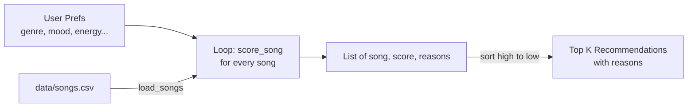

# 🎵 Music Recommender Simulation — VibeFinder 1.0

**Name:** Joshua Lookshin
**Z-number:** z23411056

## Project Summary

VibeFinder is a small, content-based music recommender written in Python. It reads a
catalog of songs from `data/songs.csv`, compares every song against a user's "taste
profile" (favorite genre, favorite mood, and target values for numbers like energy), gives
each song a score, and prints the top matches in the terminal. Every recommendation comes
with a list of reasons (for example `genre match: pop (+2.00)`), so the user can see exactly
why a song was picked.

---

## How The System Works

### How real platforms do it

Apps like Spotify, YouTube, and TikTok mix two main ideas:

- **Collaborative filtering** looks at *other users' behavior*. If many people who like
  song A also like song B, and you like song A, the system suggests song B. It doesn't need
  to know anything about the music itself, only who listened to, liked, skipped, saved, or
  playlisted what. It's great at finding surprising matches, but it struggles with brand-new
  songs or new users that have no history (the "cold start" problem).
- **Content-based filtering** looks at *the songs' own attributes*: genre, mood, tempo,
  energy, acousticness, and so on. If you like upbeat, high-energy pop, it recommends other
  songs whose attributes look like that. It works on day one, but it tends to recommend
  "more of the same."

Real systems combine both, along with signals such as play counts, skips, replays, time of
day, playlist co-occurrence, and audio analysis. The main data types involved are:

| Behavior signals (collaborative) | Song attributes (content-based) |
| --- | --- |
| likes / hearts, skips, replays | genre, mood |
| playlist adds, saves, shares | energy, tempo (BPM), valence |
| listening time, follows | danceability, acousticness |

**My version** is purely **content-based**. There are no other users to learn from, so it
puts the user's stated genre and mood first, then uses the numeric "vibe" features
(especially energy) to break ties and to reward songs that are *close* to what the user
wants.

### Features used

**`Song`** (one row of `data/songs.csv`):
`id`, `title`, `artist`, `genre`, `mood`, `energy` (0–1), `tempo_bpm`, `valence` (0–1,
musical positivity), `danceability` (0–1), `acousticness` (0–1)

**`UserProfile`** (the taste profile):
`favorite_genre`, `favorite_mood`, `target_energy` (0–1), `likes_acoustic` (True/False).
Optional targets for `valence`, `danceability`, and `tempo_bpm` can be added for a more
detailed profile.

Example taste profile (as a dictionary):

```python
user_prefs = {"genre": "pop", "mood": "happy", "energy": 0.8}
```

Is this profile enough to tell "intense rock" apart from "chill lofi"? Yes. Those two styles
differ on every field: genre (rock vs lofi), mood (intense vs chill), and energy (about 0.9
vs about 0.4). Genre and mood alone are too narrow, though. A user who loves pop but wants
something calm would get the same genre points for *Gym Hero* (intense) as for *Paper
Hearts* (sad and mellow). That's why the energy target and the optional numeric targets
matter. They separate songs *within* a genre.

### Algorithm Recipe

The **Scoring Rule** judges one song at a time:

| Rule | Points |
| --- | --- |
| Genre matches the user's favorite genre | **+2.0** |
| Mood matches the user's favorite mood | **+1.0** |
| Energy closeness | **+1.5 × (1 − \|song energy − target energy\|)** |
| Acoustic preference (`likes_acoustic`) | up to **+0.5** (acousticness if True, 1 − acousticness if False) |
| Optional valence / danceability / tempo targets | up to **+0.5** each, by closeness |

Why "closeness" instead of "higher is better": a user who wants energy 0.4 should *not*
get the loudest song in the catalog. The formula `1 − |song − target|` gives full points
for an exact match and fewer points the further away a song is, in either direction.
(The result is clamped at 0 so the score never goes negative.)

Why genre is worth more than mood: genre is the strongest single signal of whether
someone will even *listen* to a song. A metal fan is rarely happy with a "happy" country
song, but they might enjoy a less-intense metal song. Mood is still worth a full point,
and energy (worth up to 1.5) can outweigh a mood match.

The **Ranking Rule** works on the whole list: score every song, sort from highest to
lowest score, and keep the top `k`. Both rules are needed. The scoring rule answers "how
good is *this* song for *this* user?" and the ranking rule answers "which few songs should
we actually show?" A score on its own means nothing until it's compared to the others.

### Data flow



### Expected biases

- **Genre over-priority:** a +2.0 genre match can push a mediocre same-genre song above a
  song that perfectly matches the user's mood and energy in a different genre.
- **Exact-string matching:** "indie pop" doesn't count as "pop", and "melancholy" doesn't
  count as "sad", even though a human would see them as close.
- **Small, uneven catalog:** some genres have only one song, so fans of those genres will
  get one good match and then mostly filler.

---

## Getting Started

### Setup

1. Create a virtual environment (optional but recommended):

   ```bash
   python -m venv .venv
   source .venv/bin/activate      # Mac or Linux
   .venv\Scripts\activate         # Windows
   ```

2. Install dependencies

```bash
pip install -r requirements.txt
```

3. Run the app:

```bash
python -m src.main
```

### Running Tests

Run the starter tests with:

```bash
pytest
```

---

## Sample Recommendation Output

*(Filled in after implementation.)*

---

## Experiments You Tried

*(Filled in during evaluation.)*

---

## Limitations and Risks

*(Filled in during evaluation.)*

---

## Reflection

[**Model Card**](model_card.md)
